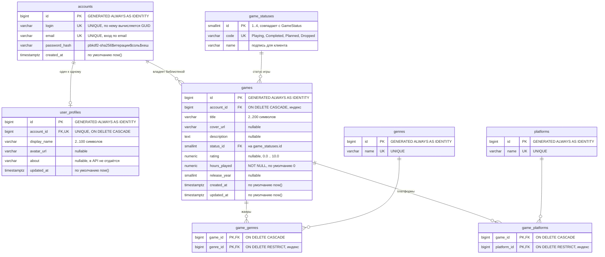

# Схема базы данных GameTrack

База данных — PostgreSQL 18. Источник истины для схемы — нумерованные скрипты в
папке [`db/`](../db). Приложение работает в режиме **database first**:
Entity Framework Core здесь только читает и пишет существующие таблицы,
миграций EF нет, `EnsureCreated()` и `Migrate()` не вызываются.

Схема приведена к третьей нормальной форме (3НФ):

- справочники `game_statuses`, `genres`, `platforms` содержат по одному факту в строке;
- игра хранит только внешние ключи: ни название жанра, ни платформа, ни статус
  в `games` не дублируются;
- связь игр с жанрами и платформами — «многие ко многим» через собственные
  таблицы `game_genres` и `game_platforms` с составными первичными ключами;
- технические ключи — `bigint GENERATED ALWAYS AS IDENTITY` (кроме `game_statuses.id`:
  это `smallint`-код), на внешних ключах есть индексы.

## ER-диаграмма

## Таблицы

| Таблица | Назначение | Ключи и ограничения |
|---|---|---|
| `accounts` | учётная запись: логин, email, хеш пароля | PK `id`, `UNIQUE(login)`, `UNIQUE(email)` |
| `user_profiles` | профиль пользователя (одна строка на аккаунт) | PK `id`, `UNIQUE(account_id)`, FK `account_id → accounts.id` `ON DELETE CASCADE` |
| `game_statuses` | справочник статусов | PK `id` (`smallint`), `UNIQUE(code)` |
| `games` | игры библиотеки пользователя | PK `id`, FK `account_id → accounts.id` `ON DELETE CASCADE`, FK `status_id → game_statuses.id`, `CHECK(rating BETWEEN 0 AND 10)`, `CHECK(hours_played >= 0)` |
| `genres` | справочник жанров | PK `id`, `UNIQUE(name)` |
| `platforms` | справочник платформ | PK `id`, `UNIQUE(name)` |
| `game_genres` | связь игры и жанров | PK `(game_id, genre_id)`, FK `game_id → games.id` `ON DELETE CASCADE`, FK `genre_id → genres.id` `ON DELETE RESTRICT` |
| `game_platforms` | связь игры и платформ | PK `(game_id, platform_id)`, FK `game_id → games.id` `ON DELETE CASCADE`, FK `platform_id → platforms.id` `ON DELETE RESTRICT` |

## Индексы

| Индекс | Таблица | Назначение |
|---|---|---|
| `ix_games_account_id` | `games` | фильтр библиотеки по владельцу |
| `ix_games_status_id` | `games` | фильтр по статусу |
| `ix_games_account_title` | `games` | сортировка и поиск названий внутри библиотеки |
| `ux_games_account_title_ci` | `games` | уникальность названия в библиотеке без учёта регистра |
| `ix_game_genres_genre_id` | `game_genres` | обратный поиск игр по жанру |
| `ix_game_platforms_platform` | `game_platforms` | обратный поиск игр по платформе |
| `ix_accounts_login_length` | `accounts` | поиск аккаунта по публичному GUID (длина логина) |

## Статусы игры

Числовой `game_statuses.id` совпадает со значением enum `GameStatus` в Domain,
а `code` — его человекочитаемое имя:

| `GameStatus` | `id` | `code` | Подпись | Значение в API |
|---|---|---|---|---|
| `InProgress` | 1 | `Playing` | В процессе | `in-progress` |
| `Completed` | 2 | `Completed` | Пройдено | `completed` |
| `WantToPlay` | 3 | `Planned` | Хочу пройти | `want-to-play` |
| `Dropped` | 4 | `Dropped` | Брошено | `dropped` |

## Ключи и идентификаторы

Клиент и API работают с `Guid`, а БД — с `bigint`. Соответствие
вычисляется детерминированно, без дополнительных таблиц:

| Сущность | Отображение | Где в коде |
|---|---|---|
| Аккаунт | `Guid` ← длина логина + SHA-256(`gametrack.account:` + логин) | `AccountIdMap` |
| Игра | `Guid` ← первые 8 байт = `games.id`, хвост фиксированный | `GameKey` |

Благодаря этому контракты API не менялись, а таблицы остались на bigint-ключах.
Подробности — в комментариях к `AccountIdMap` и `GameKey` в слое Infrastructure.

## Скрипты

| Файл | Назначение |
|---|---|
| [`db/001_create_schema.sql`](../db/001_create_schema.sql) | создание всех таблиц, ограничений и индексов |
| [`db/002_seed_reference_data.sql`](../db/002_seed_reference_data.sql) | справочные данные: статусы, жанры, платформы |
| [`db/003_seed_demo_data.sql`](../db/003_seed_demo_data.sql) | демо-аккаунт `demo@gametrack.app` и семь игр |
| [`db/004_align_existing_schema.sql`](../db/004_align_existing_schema.sql) | приведение *существующей* БД к требованиям приложения (коды статусов, дробный рейтинг, уникальность названий) |

Порядок выполнения и настройка подключения описаны в
[README, раздел «База данных»](../README.md#база-данных).
